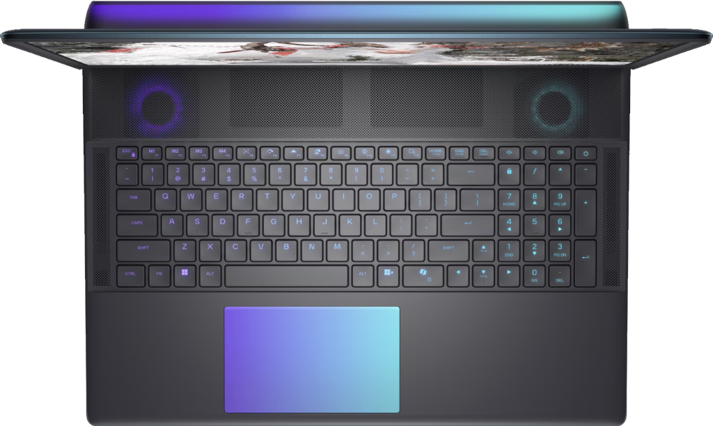
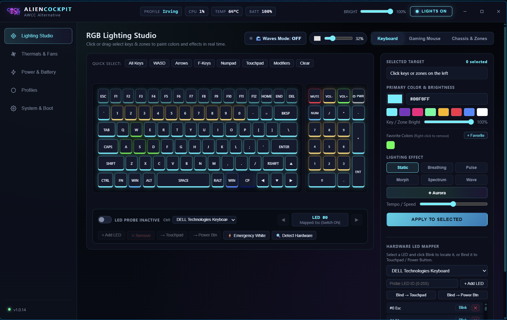
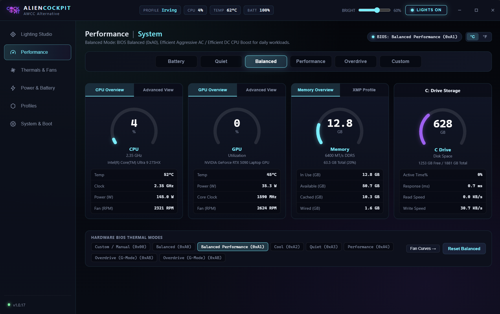

<p align="center">
  
</p>

# AlienCockpit — AWCC Alternative

**AlienCockpit** is an ultra-lightweight, low-resource command center for **Windows 11** built as a modern fork of [`alien-tools`](https://github.com/T-Troll/alien-tools). Unlike heavy vendor suites such as Alienware Command Center (AWCC), AlienCockpit consumes **minimal RAM and near-0% idle CPU** with **no bloated background telemetry or updater services**. It pairs the rock-solid hardware stability of the open-source `AlienTOOLS-SDK` and `AlienFan-SDK` C++ engines with a crisp PerMonitorV2 WebView2 interface.

<p align="center">
  
  <br />
  <sub><b>Optimized for Alienware 16 &amp; 18 Area-51 (AA18250)</b> — Full 45-LED Chassis, Rear Lightbar (#0–#30), Left/Right Fans (#34/#33), Lid Alienhead (#32), Power Button (#31), and 10-LED RGB Touchpad (#35–#44)</sub>
</p>

<p align="center">
  
  <br />
</p>

<p align="center">
  
  <br />
</p>

---

## Quick Installation (No Building Required)

You do **not** need Visual Studio or any compiler to use AlienCockpit:

1. Open the [**GitHub Releases**](https://github.com/irvingngr/alien-cockpit/releases/latest) page.
2. Download the latest precompiled `AlienCockpit-v*.zip` package.
3. Extract the folder anywhere on your PC and run **`AlienCockpit.exe`**.

*(Tip: Enable **Always Run as Administrator** in `Settings → System & Boot` if you want automatic elevated access for ACPI BIOS fan curves.)*

---

## Key Features

- **Ultra-Low Resource Usage**: Native C++20 core with minimal memory footprint and no background bloatware compared to AWCC.
- **Intuitive Visual RGB Studio**
  - Interactive **Full-Size Keyboard** (including Numpad & `⏻ Power Button`), **10-LED RGB Touchpad**, **AWCC 3-Zone Gaming Mouse** (`Side Strips & Wheel`, `Mouse Logo`, `DPI Indicator`), and **Alienware 18 Area-51 (`AA18250`) 45-LED Chassis & Zones** visual maps that reflect live hardware state.
  - Individual **Key / Zone Brightness** alongside global **Master Brightness**, plus a **Startup Keyboard Intro Animation** (with optional toggle in `System & Boot`).
  - Smooth continuous 30fps animations & speed-calibrated effects: `Static`, `Breathing`, `Pulse`, `Morph`, `Spectrum`, `Wave`, **`Aurora`** multi-color palettes, and global **`Waves Mode`** water-drop ripple overlay reacting to real keystrokes.
  - Non-destructive **Game & Theme Presets** (`Cyberpunk`, `Aurora Borealis`, `Crimson Stealth`, etc.) with 1-click **`Reset to Lighting Studio`**.
  - **Interactive Hardware LED Probe Deck**: Toggle red-signal hardware probing (`◀` / `▶` or mouse wheel) directly beneath the visual keyboard to visually identify any physical LED ID, **`+ Add LED`**, **`✕ Remove`**, or bind **`→ Touchpad`** / **`→ Power Btn`** without losing your profile.
- **Thermals, Fans & Power Modes (`AlienFan-SDK`)**
  - Live CPU/GPU/ambient temperature sensors and animated spinning **Cooling Fan Rotors** driven by live RPM telemetry.
  - High-precision drag-and-drop **Interactive Fan Curve Editor** with active preset detection (`Silent`, `Balanced`, `Gaming`, `Max Cooling`, or `Custom`).
- **Connected Device Battery Telemetry**
  - Displays real-time laptop battery percentage and charging status, plus wireless HID / Bluetooth / Windows Battery Class peripherals.
- **Profiles & Automation**
  - Create, **rename**, **duplicate**, activate, and manage custom lighting/thermal profiles with automatic switching by running applications or power source (AC / Battery).
- **Windows 11 Native Integration**
  - **Start with Windows 11** (`--minimized` support), **Always Run as Administrator** (elevated logon task option), and dynamic **System Tray** icon + battery/lights hover tooltip.
  - Immersive dark titlebar (`DWMWA_USE_IMMERSIVE_DARK_MODE`) and **PerMonitorV2** High-DPI sharpness.

---

## Requirements

- **OS**: Windows 11 (64-bit) — also compatible with Windows 10 v1903+
- **Runtime**: Microsoft Edge WebView2 Runtime (preinstalled on Windows 11)
- **Hardware**: Compatible Alienware / Dell G-Series USB/HID lighting device or ACPI BIOS fan interface

---

## Building from Source (Optional)

> Precompiled binaries are already provided in [**Releases**](https://github.com/irvingngr/alien-cockpit/releases). Only follow these steps if you want to modify or compile the source code yourself.

### Prerequisites
- Visual Studio 2022 or 2026 (Desktop development with C++ workload)
- NuGet CLI (`nuget restore AlienCockpit\packages.config -PackagesDirectory packages`)

### Build Steps
1. Clone the repository:
   ```bash
   git clone https://github.com/irvingngr/alien-cockpit.git
   ```
2. Restore NuGet packages:
   ```cmd
   nuget restore AlienCockpit\packages.config -PackagesDirectory packages
   ```
3. Open `AlienCockpit.sln` in Visual Studio and build `Release | x64`, or use MSBuild:
   ```cmd
   msbuild AlienCockpit.sln /t:AlienCockpit /p:Configuration=Release /p:Platform=x64
   ```
4. Automated builds & releases are configured via GitHub Actions (`.github/workflows/build.yml`).

---

## Disclaimer

**AlienCockpit** is provided **"as is"**, without warranty of any kind. By using this software, you acknowledge that the developer is **not responsible** for any hardware damage, LED wear, thermal issues, or other damage that may result from its use.

---

## Credits & License

**AlienCockpit** is crafted by [**Irving Ngr**](https://ngservers.net) as a lightweight Windows 11 fork of [`alien-tools`](https://github.com/T-Troll/alien-tools) by **Rik Lain (T-Troll)**. All low-level HID/USB/ACPI hardware communication is powered by `AlienTOOLS-SDK` and `AlienFan-SDK`.

Licensed under the [MIT License](LICENSE).
